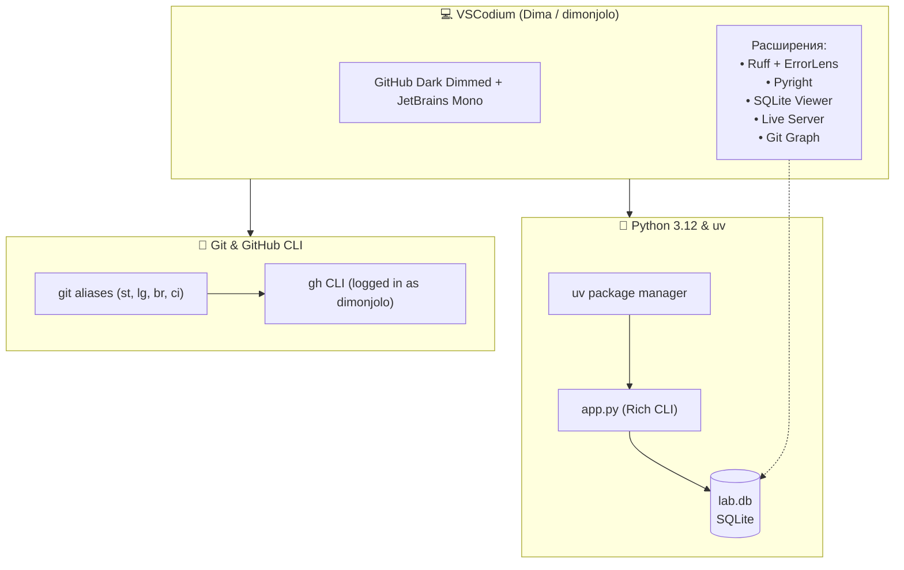

# ✦ Codium Lab Showcase

Тестовый полигон для проверки всех инструментов в **VSCodium** с окружением Python 3.12, `uv`, SQLite Viewer, Git и `gh`.

---

## 🗺 Архитектура окружения (Mermaid Preview)

> Нажмите **`Ctrl + Shift + V`** (или иконку предпросмотра вверху справа), чтобы увидеть интерактивную диаграмму:



---

## 🧪 Чек-лист проверки в VSCodium

| № | Что проверяем | Как проверить | Ожидаемый результат |
|---|---|---|---|
| 1 | **SQLite Viewer** | В проводнике слева дважды кликните на `lab.db` | Откроется GUI-таблица с вкладками `users`, `projects`, `audit_log` |
| 2 | **Rich & uv** | В терминале выполните: `uv run python app.py` | Цветная таблица, индикаторы прогресса и красивый UI |
| 3 | **ErrorLens & Pyright** | Откройте `test_lint.py` и раскомментируйте последнюю строку | Прямо в редакторе появится красная строка ошибки типизации |
| 4 | **Ruff autoformat** | В `test_lint.py` сделайте лишние пробелы и нажмите `Ctrl + S` | Ruff мгновенно выровняет код по стандартам |
| 5 | **REST Client** | Откройте `api.http` и кликните `Send Request` над запросом | Справа откроется окно с реальным JSON-ответом от GitHub API |
| 6 | **Live Server** | Откройте `index.html` и нажмите **"Go Live"** в нижнем баре | В браузере откроется стильная веб-страница со статусом |
| 7 | **Git & gh** | В терминале введите `git st`, `git lg` или `gh repo view --web` | Быстрый статус ветки main и история коммитов |

---

## ⚡ Запуск проекта

```powershell
# 1. Запустить приложение с SQLite дашбордом
uv run python app.py

# 2. Проверить статус Git
git st
```
